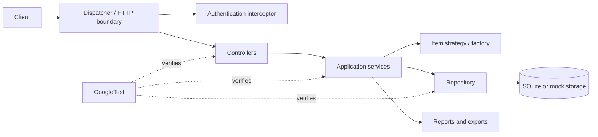

# Software Project Architecture Lab

This repository contains a C++17 Gilded Rose backend used for software architecture and quality engineering experiments. The project explores how to organize a small service around clear responsibilities, make business rules easier to extend, and verify changes with automated tests and engineering tools.

The repository is maintained as coursework and an evolving experiment. The default `main` branch and the experiment branches may not expose exactly the same features or run modes; use the source and build options on the branch you check out as the final reference.

## What is in the project

- **Inventory domain:** items have `sellIn` and `quality` values that change during daily settlement.
- **Backend components:** the source tree separates controllers, services, repositories, models, DTOs, networking, and shared utilities.
- **Architecture patterns:** the experiments apply strategies and factories to isolate item-specific rules, and a dispatcher/interceptor boundary to centralize request handling and authorization.
- **Persistence and reporting:** SQLite-backed data operations, inventory reports, and export functionality are explored across the project revisions.
- **Quality and performance work:** GoogleTest unit tests, optional Google Benchmark targets, coverage hooks, load-test assets, Docker packaging, and deployment examples are included in relevant branches.

## Repository map

| Path | Contents |
|---|---|
| `src/` | C++ application source, grouped by responsibility |
| `tests/` | GoogleTest unit and integration tests |
| `docs/` | Architecture lab reports and design notes |
| `benchmarks/` | Google Benchmark sources (optional target) |
| `bench/` | Load-test and performance-report helper scripts |
| `deploy/` | Nginx and cluster deployment configuration |
| `CMakeLists.txt` | Build configuration and optional test/benchmark targets |
| `Dockerfile`, `docker-compose.yml` | Container build and multi-instance deployment examples |

Some paths are present only on particular branches. For example, check the selected branch before relying on `bench/`, `deploy/`, or container configuration.

## Requirements

- CMake 3.14 or newer
- A C++17 compiler (GCC or Clang)
- SQLite3 development headers and library
- Git, if CMake needs to fetch GoogleTest or Google Benchmark for optional targets

## Build and run

Build the default application target:

```bash
cmake -S . -B build
cmake --build build -j
```

The default target is named `GildedRoseBackend`. Runtime arguments and available modes depend on the checked-out branch. Inspect that branch's `src/main.cpp` before starting the executable; some revisions are command-line demos, while later experiment revisions may provide a server mode.

## Build and run tests

GoogleTest is fetched by CMake when `BUILD_TESTS` is enabled, so the initial configuration needs network access.

```bash
cmake -S . -B build-tests -DBUILD_TESTS=ON
cmake --build build-tests -j
ctest --test-dir build-tests --output-on-failure
```

To build the optional benchmark target on a branch that contains benchmark sources:

```bash
cmake -S . -B build-benchmarks -DBUILD_BENCHMARKS=ON
cmake --build build-benchmarks --target GildedRoseBenchmarks -j
```

The benchmark option fetches Google Benchmark. Optional Redis support is controlled by `USE_REDIS`; when hiredis is unavailable, the project may use its in-process cache fallback depending on branch configuration.

## Architecture at a glance



The diagram describes the architectural responsibilities represented across the experiment branches. Follow the implementation on the branch you are using when class names or infrastructure differ.

## Experiments and design goals

The lab focuses on software qualities that become visible as the code evolves:

1. **Modifiability:** keep item-specific settlement rules isolated so adding a rule does not spread conditionals through the service layer.
2. **Readability:** give each component one clear responsibility and keep business rules separate from transport and persistence details.
3. **Testability:** validate behavior through focused unit tests and use coverage or benchmark tools when the experiment calls for them.
4. **Security:** validate request inputs, centralize authorization checks, and use parameterized database operations rather than building SQL from user input.
5. **Performance and scalability:** measure before optimizing; selected branches include load-test scripts, caching, thread pools, and deployment experiments.

Reports and design discussion are collected under [`docs/`](docs/). Read the report for the experiment you are studying because the repository records multiple stages of the architecture's evolution.

## Container deployment

On branches containing `Dockerfile` and `docker-compose.yml`, a local multi-container deployment can be started with:

```bash
docker compose up --build
```

Check the compose file and deployment notes for the exposed ports, authentication behavior, seed data, and health checks of that branch. Do not treat demo credentials or tokens in coursework configurations as production secrets.

## Contributing and coursework use

Changes should include tests for behavior changes and update the relevant architecture report when they alter a design decision or experiment result. Keep generated build directories, local databases, test output, credentials, and personal data out of commits. Clearly distinguish measured results from estimates in performance reports.

This is an educational project, not a production-ready inventory or authentication service. Review security, persistence, configuration, and operational requirements before adapting it for real deployments.
